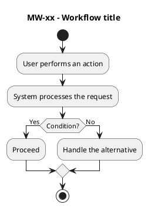

# METANOIA — Activity Diagrams for Main Flows

> **11 diagrams** in `activity-diagrams/`, each `.puml` file with a rendered `.svg`.
> Each diagram maps to exactly **one Main Workflow (MW-xx)** in `Workflow.md` (section A.1.1).
> All diagrams use the **basic activity diagram** style: no swimlanes, plain top-down flow.

---

## 1. Diagram list

| File | Main Workflow | Content |
|---|---|---|
| `mw01-sign-in-profile-setup.puml` | MW-01 | Sign in + profile setup |
| `mw02-client-management.puml` | MW-02 | Create / edit / delete / view clients |
| `mw03-project-milestone-setup.puml` | MW-03 | Create project + milestone |
| `mw04-manual-task-planning.puml` | MW-04 | Create tasks / subtasks + slot scheduling |
| `mw05-ai-task-decomposition.puml` | MW-05 | AI proposes subtasks → apply |
| `mw06-ai-schedule-proposal.puml` | MW-06 | AI proposes schedule → approve each slot |
| `mw07-calendar-google-sync.puml` | MW-07 | View calendar + connect / sync Google |
| `mw08-focus-session-execution.puml` | MW-08 | Start timer → work → stop → mark done |
| `mw09-notifications-reminders.puml` | MW-09 | Realtime reminders + inbox |
| `mw10-plan-upgrade-payment.puml` | MW-10 | Buy plan → pay → activate |
| `mw11-daily-briefing.puml` | MW-11 | Aggregated daily briefing |

---

## 2. Drawing conventions

### 2.1. Basic activity diagram (no swimlanes)

Each diagram is a single, linear flow of activities:

- Every step is a single `:Action;` step.
- Decisions are `if (...) then (...)` / `elseif (...) then (...)` / `else (...)` / `endif`.
- The diagram starts with `start` and ends with `stop`.
- User actions and system actions are written in the same flow — no lane partitioning.

> **No Frontend / Backend / AI Service split.** For an Activity Diagram the reader only needs to know "who acts" and "what the system does automatically". Architectural detail belongs in an architecture diagram or a Sequence Diagram.

### 2.2. "Main flow" principle

Each diagram keeps **only the main flow**:
- ✅ Main user actions and system actions
- ✅ Decisions that affect the flow (success / failure, business branch)
- ✅ Entry state → exit state
- ❌ No HTTP status codes, error codes, endpoint names
- ❌ No many small error branches
- ❌ No repeating small steps

### 2.3. PlantUML syntax



**Common mistakes to avoid:**
1. Every action must be wrapped in `:...;` — never leave an action empty.
2. `elseif` supports multiple branches, but keep the nesting shallow.
3. `note right` must be closed with `end note`.
4. No `|User|` / `|System|` lane declarations — the diagrams are intentionally lane-free.

### 2.4. Re-render the SVGs

```powershell
cd activity-diagrams
java -jar plantuml.jar -charset UTF-8 -tsvg *.puml
```

Use `-tpng` instead of `-tsvg` to export PNG.

---

## 3. Easy-to-miss points per diagram

### MW-01 — Sign in
- The failure branch must **loop back** to the credential entry step, not end the flow.
- Onboarding gate: profile exists → go straight in; not set up → do onboarding first.

### MW-04 — Manual planning
- The "no milestone yet" branch is a **precondition**, drawn as a fork at the start of the flow.
- Fixed-time tasks → the system auto-creates an approved slot. Flexible tasks → no slot is created.
- Slot splitting: select one subtask → 1 slot; select the whole task → split by each subtask duration.

### MW-05 — AI task decomposition
- The "AI busy" branch → auto-retry (up to 2 times) → **not** an error state.
- The "review and apply" step needs a **human decision**, so it belongs to the user part of the flow.

### MW-06 — AI schedule proposal
- The "not enough free time" branch only skips **that task**; other tasks are still scheduled → draw it as a parallel branch, not a flow stop.
- Approving each slot is a user action.
- Each slot is written individually, not in a batch.

### MW-08 — Focus session (most important)
- **The timer counts per time slot, not per task.** When slot 1 runs out, the warning appears even if the task still has other subtasks.
- **There is no auto-rollover** — after slot 1 ends, slot 2 still waits, the user must click Start again.
- Stop reason "Completed" → the slot becomes completed; any other reason → the slot returns to the pending state.
- **Stopping a session does NOT auto-mark the task/subtask done.** Draw the explicit user confirmation step.
- If a session is already running → switch to it, don't report an error.

### MW-09 — Notifications
- The wait-for-event loop lives in the system part of the flow.
- Opening the inbox and marking as read are user actions.

### MW-10 — Payment
- The "pending" status → the system auto-reconciles, it is **not** a failure.
- The plan is only activated once the backend confirms success.

---

## 4. Submission checklist

- [ ] All **11 diagrams** present, matching MW-01 → MW-11.
- [ ] Each diagram uses the **basic activity diagram** style (no swimlanes).
- [ ] Only the **main flow** — no HTTP status codes or endpoint names.
- [ ] Every decision leads to a concrete action, never stopping at "error".
- [ ] Important error branches **loop back** into the flow instead of ending it.
- [ ] Starts with `start`, ends with `stop`.
- [ ] Has a `title` matching the workflow name in `Workflow.md`.
- [ ] Cross-checked against the step list in `Workflow.md` (section A.1.2).

---

## 5. If you need to merge some diagrams

`Workflow.md` states "Number of Main Workflows: **10**" but the table lists **11** (MW-01 → MW-11, because MW-11 Briefing was added later). If the reviewer requires exactly 10, the cleanest options are:

| Merge option | Result |
|---|---|
| Merge MW-02 into MW-03 | "Client, project and milestone management" — reasonable because clients are the first precondition of a project |
| Merge MW-05 into MW-04 | "Task and subtask planning (manual and AI)" |

**MW-09** (notifications) and **MW-11** (briefing) are reactive flows — they should not be merged with anything, and can be considered supporting diagrams.
